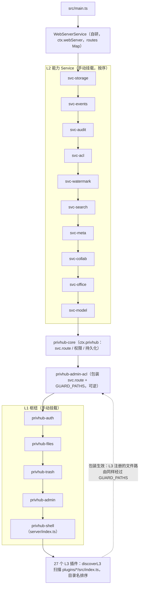
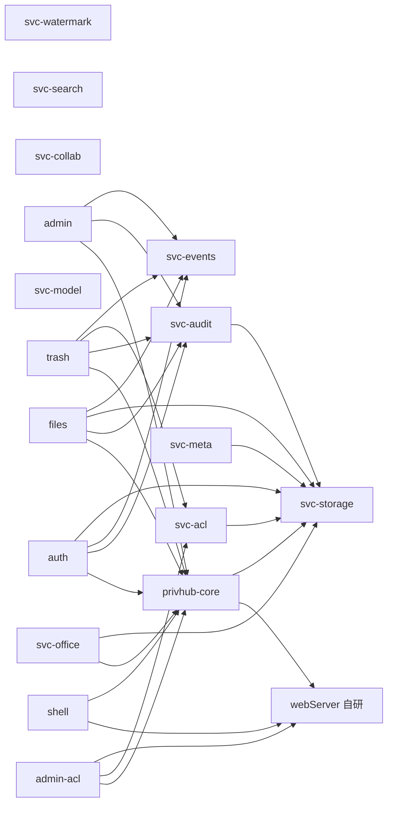
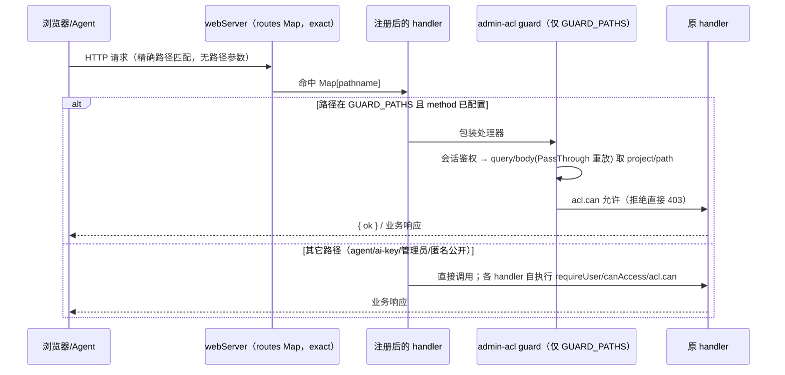

# PrivHub 插件路由注册核查与模块依赖图（T-001）

> 任务：T-001 检查 `plugins/` 目录，确认所有含 `src/index.ts` 的插件是否正确注册路由，并输出依赖图。
>
> 基线：`a52989b`（main，与 `origin/main` 同步）｜分支：`feat/T-001`｜工作区：`worktrees/trae`
> 扫描日期：2026-09-24｜扫描口径：`privhub/plugins/` 下非 `_` 开头目录（`_retired-v2/` 依装配规则排除）
> 判定依据：[privhub/src/main.ts](file:///g:/program/dsh-SQL/worktrees/trae/privhub/src/main.ts)、[privhub/plugins/privhub-core/src/index.ts](file:///g:/program/dsh-SQL/worktrees/trae/privhub/plugins/privhub-core/src/index.ts) 的 `svc.route()`、[privhub/plugins/privhub-admin-acl/src/index.ts](file:///g:/program/dsh-SQL/worktrees/trae/privhub/plugins/privhub-admin-acl/src/index.ts) 的 `GUARD_PATHS`、《PrivHub-插件实现规则》§3/§5、根 `CLAUDE.md`「HTTP layer」。

---

## 1. 结论摘要（TL;DR）

| # | 检查项 | 结果 | 证据 |
| --- | --- | --- | --- |
| 1 | 含 `src/index.ts` 的插件均为标准形态（导出 `name` + `apply`），可被装配 | ✅ 43/43 | 16 核心手动挂载 + 27 L3 自动发现；`discoverL3()` 无跳过项 |
| 2 | 插件 `name` 无重名、`inject` 键全部存在对应服务 | ✅ 0 冲突 / 0 未知键 | cordis 键集合：`webServer/storage/eventBus/audit/acl/watermark/search/meta/collab/office/model/privhub` |
| 3 | 路由路径无重复注册（flat Map exact-match） | ✅ 115 条运行时路径，0 冲突 | `webServer.register()` 为 `routes.set(path, handler)`，重复会静默覆盖——实测无重复 |
| 4 | 路由注册均走 `svc.route()`（带 `ctx.effect` 可逆回收） | ✅ 115/115 | 未发现绕过 core 直接访问 `webServer.routes` 的业务注册 |
| 5 | effect label（第三参数） | 🟡 94/115 带 label；**21 条 agent 路由的 label 未送达 `svc.route`** | 见发现项 F-01 |
| 6 | 文件级路由进入 admin-acl `GUARD_PATHS`（37 条） | ✅ 浏览器会话文件路由已覆盖；2 处观察项 | 见发现项 F-02/F-03（F-02 为源码自认遗留） |
| 7 | 挂载顺序无倒置（L2→L1→L3，L3 不 inject 其它 L3） | ✅ | 27 个 L3 的 inject 全部指向 L2/core |
| 8 | 动态拼接路径 | ✅ 2 处循环注册，展开为 4 条固定具体路径，无通配/无参数路径 | keys `suspend/resume`、trash `restore/purge` |
| 9 | 路由 handler 运行时健全性（回归日志） | 🔴 发现 1 个必现 500：撤销发布 | 见发现项 **F-05**（`DELETE /privhub/api/publish` 漏传 `storage` 实参） |

**总体判定：注册机制正确、完整（路径无冲突、形态全部合格、守卫链成立）；但回归日志暴露 1 个既有运行时缺陷（F-05，撤销发布必 500）。** 另有 1 个规范一致性偏差（F-01，不影响功能）、1 个已记录在案的守卫遗留（F-02）、1 个颗粒度观察（F-03）、2 处文档漂移（F-04）。按《插件实现规则》§6.1 第 7 条，本次**只报告不修改**，是否治理由用户决定。

---

## 2. 装配模型（路由从哪里来）

路由只有一条注册通道：插件 `apply(ctx)` 内调用 `ctx.privhub.route(path, handler, label)`，core 将其包为 cordis `ctx.effect(() => ctx.webServer.register({ kind: 'exact', path, handler }), label)`，最终进入自研 webServer 的 `routes: Map<pathname, handler>`（**精确匹配，无路径参数**）。

- **核心清单（17 个，`main.ts` 手动 mount）**：10 个 L2 service + core + admin-acl + auth + files + trash + admin + shell。
  其中 `privhub-shell` 的后端入口是 **`server/index.ts` 而非 `src/index.ts`**（本任务口径之外，下表单独列出）。
- **L3 功能插件（自动发现）**：`main.ts` 扫描 `<root>/plugins/*/src/index.ts`，按目录名排序，跳过 `_` 前缀与 `CORE_PLUGINS`，要求模块同时具备字符串 `name` 与函数 `apply`，否则打印「跳过（非标准插件形态）」。
- **ACL 包装**：`privhub-admin-acl` 在 auth/files/trash/admin 与全部 L3 之前挂载，monkey-patch `svc.route`：路径命中 `GUARD_PATHS` 且 method 命中配置时，先做文件级 ACL 裁决再（body 类经 PassThrough 重放）交给原 handler。包装本身是可逆 effect。

### 2.1 装配分层与顺序



---

## 3. 插件清单（50 个目录的归类）

### 3.1 含 `src/index.ts` 的 43 个（本任务范围）

**核心手动挂载（16 个，`CORE_PLUGINS` 中除 shell）**

| 插件 | inject（cordis 键） | 路由数 | 备注 |
| --- | --- | --- | --- |
| privhub-svc-storage | — | 0 | 最先挂载；AES-256-GCM 存储 |
| privhub-svc-events | — | 0 | 事件注册表 |
| privhub-svc-audit | storage | 0 | 审计 JSONL |
| privhub-svc-acl | storage | 0 | ACL 规则引擎 |
| privhub-svc-watermark | — | 0 | 水印能力 |
| privhub-svc-search | — | 0 | BM25 检索能力 |
| privhub-svc-meta | storage | 0 | 标签/自定义字段能力 |
| privhub-svc-collab | — | 0 | 协同骨架 |
| privhub-svc-office | privhub, storage | 0 | Office 能力库（含 `office-lib.mjs`） |
| privhub-svc-model | — | 0 | M0 模型接入 |
| privhub-core | webServer, storage | 1 | `/privhub/api/health`（系统探活） |
| privhub-admin-acl | privhub, acl, webServer | 2 | 路由守卫 + 规则管理 API |
| privhub-auth | privhub, audit, eventBus, storage | 5 | 登录/注册/会话 |
| privhub-files | privhub, audit, storage, eventBus | 10 | 文件核心 API |
| privhub-trash | privhub, audit, acl, eventBus | 4 | 回收站 |
| privhub-admin | privhub, audit, eventBus | 6 | 用户/项目权限管理 |

**L3 自动发现（27 个，均通过标准形态校验）**

| 插件 | inject | 路由数 | 说明 |
| --- | --- | --- | --- |
| privhub-admin-audit | privhub, audit, eventBus | 4 | 审计查询/导出 |
| privhub-auth-watermark | privhub, watermark | 1 | 水印图 |
| privhub-files-agent | privhub, storage, audit, acl, eventBus | 21 | Agent API（17 字面注册 + 循环展开 4），独立密钥通道 |
| privhub-files-comments | storage, privhub | 3 | 文档批注 |
| privhub-files-dataview | storage, privhub, office | 1 | 数据表页 |
| privhub-files-edit-md | privhub, audit, storage, eventBus | 4 | Markdown 编辑 |
| privhub-files-explorer-v3 | — | 0 | **空 apply**：服务端查重已下线并入 svc-rag，插件位为 client 保留（源码注释明示） |
| privhub-files-export | privhub, storage | 1 | 导出 |
| privhub-files-fulltext | privhub, storage, search, audit, eventBus | 1 | 全文检索 |
| privhub-files-invite | storage, privhub | 5 | 邀请链接 |
| privhub-files-kg | privhub, storage, meta, eventBus | 1 | 知识图谱 |
| privhub-files-mdpage | storage, privhub | 1 | MD 展示页 |
| privhub-files-office | privhub, storage | 1 | Office 读取/预览 |
| privhub-files-office-ai | privhub, office, storage, audit | 4 | Office 外部 AI（X-Office-Key 通道） |
| privhub-files-office-ui | privhub, office, acl, audit, eventBus | 3 | Office 人工编辑 |
| privhub-files-office2 | storage, privhub, office | 3 | Office 原生预览/独占编辑 |
| privhub-files-publish | storage, privhub | 3 | 内网免登录发布（含 `/pub`） |
| privhub-files-search | privhub, search | 1 | 文件名搜索 |
| privhub-files-tags | privhub, meta, eventBus | 3 | 文件标签 |
| privhub-files-template | privhub, meta | 1 | 模板新建 |
| privhub-files-versions | storage, privhub | 3 | 版本历史 |
| privhub-git-backup | storage, privhub, acl | 4 | Git 裸仓备份 |
| privhub-shell-agent-console | — | 0 | **空 apply**：纯前端开发者平台，数据全走 files-agent 端点（头注释明示） |
| privhub-shell-favorites | privhub, storage | 1 | 收藏 |
| privhub-shell-recent | privhub, storage, eventBus | 1 | 最近打开 |
| privhub-shell-settings | privhub, storage | 1 | 系统设置 |
| privhub-svc-rag | privhub, storage, audit, eventBus, model, office, search, acl | 14 | RAG 总台（虽以 svc- 命名，实为 L3 自动发现；其依赖的 L2 均已先挂载） |

### 3.2 不含 `src/index.ts` 的 7 个目录（不在本任务口径内，登记备查）

| 目录 | 后端入口 | 性质 |
| --- | --- | --- |
| privhub-shell | `server/index.ts`（1 条路由：`/privhub/api/shell/manifest`） | 核心手动挂载，仅入口命名例外 |
| privhub-admin-audit-panel / privhub-admin-console / privhub-files-upload / privhub-files-upload-queue / privhub-files-wiki / privhub-trash-ui | 无 | 纯前端插件（client/manifest.json + index.js），服务端永不挂载，符合规则 |
| `_retired-v2/`（files-explorer、files-preview、shell-tabs） | — | 归档目录，发现器以 `_` 前缀跳过 |

---

## 4. 路由注册全矩阵（115 条运行时路径）

口径：43 个 src 插件共 **114 条**（110 处字面量注册 + 2 处循环注册展开 4 条），shell 的 `server/index.ts` 1 条单列。

列含义：**方法校验**＝handler 内显式出现的 method 判断（`—` 表示处理器内不再分流，按单一语义调用）；**ACL**＝`GUARD_PATHS` 配置裁决的 method（`—` 为不经文件级守卫，豁免理由见 §5.3）；**label**＝`svc.route` 第三参 effect 标签（`NO`＝缺失，`loop`＝循环展开注册）。

| 插件 | 路径 | 方法校验 | ACL 裁决 | label |
| --- | --- | --- | --- | --- |
| privhub-admin | /privhub/api/admin/user-delete | — | —（管理员） | yes |
| privhub-admin | /privhub/api/admin/user-reset-password | — | —（管理员） | yes |
| privhub-admin | /privhub/api/admin/user-update | — | —（管理员） | yes |
| privhub-admin | /privhub/api/admin/users | — | —（管理员） | yes |
| privhub-admin | /privhub/api/project-create | — | —（管理员） | yes |
| privhub-admin | /privhub/api/project-delete | — | —（管理员） | yes |
| privhub-admin-acl | /privhub/api/acl/policy | method-check | —（规则管理，handler 内鉴权） | yes |
| privhub-admin-acl | /privhub/api/acl/rules | DELETE/GET | —（规则管理，handler 内鉴权） | yes |
| privhub-admin-audit | /privhub/api/audit | — | —（管理员） | yes |
| privhub-admin-audit | /privhub/api/audit/export | — | —（管理员） | yes |
| privhub-admin-audit | /privhub/api/audit/recent | — | —（管理员） | yes |
| privhub-admin-audit | /privhub/api/audit/stats | — | —（管理员） | yes |
| privhub-auth | /privhub/api/login | POST | —（认证端点） | yes |
| privhub-auth | /privhub/api/logout | — | — | yes |
| privhub-auth | /privhub/api/me | — | — | yes |
| privhub-auth | /privhub/api/me/display-name | POST | — | yes |
| privhub-auth | /privhub/api/register | POST | — | yes |
| privhub-auth-watermark | /privhub/api/watermark | — | —（图片生成，handler 内鉴权） | yes |
| privhub-core | /privhub/api/health | — | —（匿名探活，设计如此） | yes |
| privhub-files | /privhub/api/projects | — | —（按 visibleProjects 过滤） | yes |
| privhub-files | /privhub/api/list | — | **GET view** | yes |
| privhub-files | /privhub/api/preview | — | **GET view** | yes |
| privhub-files | /privhub/api/preview-raw | — | **GET view** | yes |
| privhub-files | /privhub/api/download | — | **GET view** | yes |
| privhub-files | /privhub/api/upload | POST | **POST upload** | yes |
| privhub-files | /privhub/api/mkdir | — | **POST upload** | yes |
| privhub-files | /privhub/api/delete | — | **POST delete** | yes |
| privhub-files | /privhub/api/rename | — | **POST edit** | yes |
| privhub-files | /privhub/api/move | — | **POST edit（from 字段）** | yes |
| privhub-files-agent | /privhub/api/agent/v1/schema | — | —（pha_ 密钥/会话双通道自鉴权） | **NO** |
| privhub-files-agent | /privhub/api/agent/v1/me | — | —（密钥通道） | **NO** |
| privhub-files-agent | /privhub/api/agent/v1/projects | — | —（scope + canAccess） | **NO** |
| privhub-files-agent | /privhub/api/agent/v1/list | — | —（内部 acl.can view） | **NO** |
| privhub-files-agent | /privhub/api/agent/v1/read | — | —（内部 acl.can view） | **NO** |
| privhub-files-agent | /privhub/api/agent/v1/write | POST | —（专属空间/项目 403，独立通道） | **NO** |
| privhub-files-agent | /privhub/api/agent/v1/fork | POST | —（项目只读复制） | **NO** |
| privhub-files-agent | /privhub/api/agent/v1/rename | POST | —（专属空间内） | **NO** |
| privhub-files-agent | /privhub/api/agent/v1/delete | POST | —（专属空间内） | **NO** |
| privhub-files-agent | /privhub/api/agent/v1/versions | — | — | **NO** |
| privhub-files-agent | /privhub/api/agent/v1/versions/restore | POST | — | **NO** |
| privhub-files-agent | /privhub/api/agent/v1/console | — | —（网页会话 + 管理员） | **NO** |
| privhub-files-agent | /privhub/api/agent/v1/keys | GET/POST | —（requireAdmin） | **NO** |
| privhub-files-agent | /privhub/api/agent/v1/keys/revoke | POST | —（requireAdmin） | **NO** |
| privhub-files-agent | /privhub/api/agent/v1/keys/rotate | POST | —（requireAdmin） | **NO** |
| privhub-files-agent | /privhub/api/agent/v1/keys/suspend | POST | —（循环注册，requireAdmin） | loop |
| privhub-files-agent | /privhub/api/agent/v1/keys/resume | POST | —（循环注册，requireAdmin） | loop |
| privhub-files-agent | /privhub/api/agent/v1/my-keys | GET/POST/DELETE | —（仅本人自助） | **NO** |
| privhub-files-agent | /privhub/api/agent/v1/trash | — | —（requireAdmin） | **NO** |
| privhub-files-agent | /privhub/api/agent/v1/trash/restore | POST | —（循环注册，requireAdmin） | loop |
| privhub-files-agent | /privhub/api/agent/v1/trash/purge | POST | —（循环注册，requireAdmin） | loop |
| privhub-files-comments | /privhub/api/comments | GET/DELETE/POST | **GET view**（写类见 F-02） | yes |
| privhub-files-comments | /privhub/api/comments/reply | — | —（见 F-02，按批注 id 定位） | yes |
| privhub-files-comments | /privhub/api/comments/status | — | —（见 F-02，按批注 id 定位） | yes |
| privhub-files-dataview | /privhub/api/dataview/new | — | **POST edit** | yes |
| privhub-files-edit-md | /privhub/api/doc | GET/PUT | **GET view / PUT edit** | yes |
| privhub-files-edit-md | /privhub/api/text/save | POST | **POST edit** | yes |
| privhub-files-edit-md | /privhub/api/doc/versions | — | **GET view** | yes |
| privhub-files-edit-md | /privhub/api/doc/restore | POST | **POST edit** | yes |
| privhub-files-export | /privhub/api/export | — | **GET view** | yes |
| privhub-files-fulltext | /privhub/api/fulltext/search | — | **GET view**（且排除个人空间） | yes |
| privhub-files-invite | /privhub/api/invite | DELETE | —（邀请码体系，handler 内鉴权） | yes |
| privhub-files-invite | /privhub/api/invite/create | — | —（项目成员写） | yes |
| privhub-files-invite | /privhub/api/invite/list | — | — | yes |
| privhub-files-invite | /privhub/api/invite/info | — | —（码兑换，可未登录） | yes |
| privhub-files-invite | /privhub/api/invite/join | — | —（码兑换，可未登录） | yes |
| privhub-files-kg | /privhub/api/kg | — | **GET view** | yes |
| privhub-files-mdpage | /privhub/api/mdpage/generate | — | **POST edit** | yes |
| privhub-files-office | /privhub/api/office-preview | — | **GET view** | yes |
| privhub-files-office-ai | /privhub/api/ai/office/schema | GET/POST | —（X-Office-Key，canAccess+acl.can 自执行） | yes |
| privhub-files-office-ai | /privhub/api/ai/office/read | — | —（同上，view） | yes |
| privhub-files-office-ai | /privhub/api/ai/office/write | — | —（同上，edit） | yes |
| privhub-files-office-ai | /privhub/api/ai/office/keys | GET/POST/DELETE | —（管理员签发/吊销） | yes |
| privhub-files-office-ui | /privhub/api/office/read | — | **GET view** | yes |
| privhub-files-office-ui | /privhub/api/office/write | — | **POST edit** | yes |
| privhub-files-office-ui | /privhub/api/office/convert-doc | POST | **POST edit** | yes |
| privhub-files-office2 | /privhub/api/office2/lock | GET/DELETE/POST | **GET view**（锁查询；写锁语义在 handler） | yes |
| privhub-files-office2 | /privhub/api/office2/raw | — | **GET view** | yes |
| privhub-files-office2 | /privhub/api/office2/save | POST | **POST edit** | yes |
| privhub-files-publish | /privhub/api/publish | DELETE/POST | **POST edit**（DELETE 透传；且撤销当前必 500，见 F-05） | yes |
| privhub-files-publish | /privhub/api/publish/list | — | **GET view** | yes |
| privhub-files-publish | /pub | — | —（匿名只读分享，设计如此） | yes |
| privhub-files-search | /privhub/api/search | — | **GET view**（强制带 project） | yes |
| privhub-files-tags | /privhub/api/meta/tags | GET/POST | **GET view / POST edit** | yes |
| privhub-files-tags | /privhub/api/meta/tags/all | — | —（全量标签名，元数据级） | yes |
| privhub-files-tags | /privhub/api/meta/tagged | — | **GET view** | yes |
| privhub-files-template | /privhub/api/templates | GET/POST/PUT/DELETE | —（系统模板库，handler 内鉴权） | yes |
| privhub-files-versions | /privhub/api/versions | — | **GET view** | yes |
| privhub-files-versions | /privhub/api/versions/snapshot | — | **POST view** | yes |
| privhub-files-versions | /privhub/api/versions/restore | — | **POST edit** | yes |
| privhub-git-backup | /privhub/api/gitbackup/commit | POST | —（requireUser + canAccess） | yes |
| privhub-git-backup | /privhub/api/gitbackup/status | — | — | yes |
| privhub-git-backup | /privhub/api/gitbackup/history | — | —（canAccess 但未走 acl.can view，见 F-03） | yes |
| privhub-git-backup | /privhub/api/gitbackup/restore | POST | —（canAccess + acl.can edit 自执行） | yes |
| privhub-shell-favorites | /privhub/api/favorites | GET/DELETE/POST | —（按 username 隔离，写时 canAccess；见 F-03） | yes |
| privhub-shell-recent | /privhub/api/recent | GET/POST | —（按 username 隔离；见 F-03） | yes |
| privhub-shell-settings | /privhub/api/settings | GET/POST | —（个人/系统设置） | yes |
| privhub-svc-rag | /privhub/api/model/config | GET/POST | —（role==admin 闸门） | yes |
| privhub-svc-rag | /privhub/api/model/status | — | — | yes |
| privhub-svc-rag | /privhub/api/rag/status | — | — | yes |
| privhub-svc-rag | /privhub/api/rag/corpus | — | —（管理员治理） | yes |
| privhub-svc-rag | /privhub/api/rag/pending | — | —（管理员治理） | yes |
| privhub-svc-rag | /privhub/api/rag/dup | — | — | yes |
| privhub-svc-rag | /privhub/api/rag/curate | POST | —（管理员治理） | yes |
| privhub-svc-rag | /privhub/api/rag/rebuild | POST | —（管理员治理） | yes |
| privhub-svc-rag | /privhub/api/rag/ingest | POST | —（管理员治理；摄取口拦个人空间） | yes |
| privhub-svc-rag | /privhub/api/rag/vectorize/status | — | — | yes |
| privhub-svc-rag | /privhub/api/rag/vectorize | POST | —（管理员治理） | yes |
| privhub-svc-rag | /privhub/api/rag/search | — | —（问答检索，按可见项目） | yes |
| privhub-svc-rag | /privhub/api/rag/ask | POST | — | yes |
| privhub-svc-rag | /privhub/api/rag/discover | POST | —（管理员治理） | yes |
| privhub-trash | /privhub/api/trash-list | — | **GET view** | yes |
| privhub-trash | /privhub/api/trash-restore | — | **POST edit（resolve 回原路径）** | yes |
| privhub-trash | /privhub/api/trash-purge | — | **POST delete（resolve 回原路径）** | yes |
| privhub-trash | /privhub/api/trash-clean | — | —（源码注释明示 adminOnly，清空回收站） | yes |
| privhub-shell（入口例外） | /privhub/api/shell/manifest | — | —（未登录返回 partial，登录死锁防护） | yes |

> 注：`GUARD_PATHS` 对 `/privhub/api/publish` 只配了 POST edit；该路径 handler 同时承接 DELETE（撤销发布）。DELETE 不在配置中即「透传原 handler」，由 handler 自身保证鉴权（404/403 检查在写入之前）——ACL 设计上无越权窗口；但该 method 当前因 F-05 必现 500。

---

## 5. 检查发现项（只报告，不修改）

### F-01（规范一致性，低）files-agent 21 条路由的 label 没有送达 `svc.route`

[privhub-files-agent/src/index.ts](file:///g:/program/dsh-SQL/worktrees/trae/privhub/plugins/privhub-files-agent/src/index.ts) 的实际写法是：

```ts
svc.route('/privhub/api/agent/v1/schema', wrap(async (ctx, env, req, res) => {
  // ...
}, 'agent-schema'))   // ← label 是 wrap() 的第二参
```

而公共包装器定义为 `function wrap(handler) { ... }`——**只声明一个形参**，`'agent-schema'` 作为第二参被 JavaScript 静默忽略；真正的注册通道 `svc.route(path, handler, label)` 只收到 2 个参数。文件内第 393 行定义了会正确转发 label 的本地 helper（`const route = (path, handler, label) => svc.route(path, wrap(handler), label)`），但**从未被使用**。

- 影响：无功能影响。`ctx.effect` 不传 label 仍正常注册 disposer，插件停用/卸载时路由照常回收；差异仅在 cordis effect 账目标签缺失，排障时看不到人类可读名称。
- 建议（待用户决定）：把 21 处 `svc.route(p, wrap(h, 'x'))` 统一改为使用 helper `route(p, h, 'x')`，或去掉 `wrap` 末尾这些无效字符串以免误导读者。

### F-02（已记录遗留，中低）批注写操作未纳入文件级 ACL

`GUARD_PATHS` 中 `/privhub/api/comments` 只裁决 **GET**；`comments/reply`、`comments/status` 两条写路由未登记。admin-acl 源码注释原话：「写类经 id 定位（本轮暂不纳入，记录后续治理）」——属**作者已自认的遗留项**，本次核查确认其仍然存在。批注记录按 id 定位、handler 内有登录与项目归属校验，风险有限；是否补 resolve 回调（参考 trash-restore 的写法）由用户决定。

### F-03（观察项，低）个别文件触碰路由的鉴权颗粒度

- `privhub-git-backup`：`history` 做了 `requireUser + canAccess`，但未像同插件 `restore`（`acl.can('edit')`）那样做文件级 `acl.can('view')` 裁决，两端点颗粒度不一致。
- `favorites` / `recent`：数据按 `username` 隔离（读仅见本人记录），写入时有 `canAccess` 校验；不返回文件内容、仅导航元数据，且项目权限被收回后列表会按 `visibleProjects` 过滤（recent 已实现）。现状可接受，登记备查。

### F-04（文档漂移，低）既有文档统计口径过期

对照《PrivHub-插件实现规则》§0（2026-09-14 基线）：

1. 现网实为 **16 核心（src）+ 27 L3 = 43 个 `src/index.ts`**（文档写「17 核心 + 26 L3」，差异＝shell 用 `server/index.ts`，且新增了 `privhub-shell-agent-console`，文档表 0.3 无此行）；
2. 路由 **115 条**（文档写 112；新增来源含 RAG/Agent 端点扩展与 4 条循环展开路径）；
3. 同文 §3.1 称 core「不暴露任何 HTTP 接口」，实际 core 注册了 `/privhub/api/health`（系统探活，属合理例外，建议补注一句）。

### F-05（既有功能缺陷，中，本次回归日志实锤）撤销发布 `DELETE /privhub/api/publish` 必现 500

[privhub-files-publish/src/index.ts](file:///g:/program/dsh-SQL/worktrees/trae/privhub/plugins/privhub-files-publish/src/index.ts) 中模块级辅助函数签名为 `save(storage: StorageLike, list: Pub[])`（第 43 行），POST 发布分支调用正确（第 109 行 `save(ctx.storage, list)`），但 **DELETE 撤销分支第 82 行漏传第一个参数**：

```ts
await save(list.filter(p => p.code !== code))   // 实参少了 ctx.storage
```

于是函数体内 `storage.writeText` 实际作用在数组上，抛出 `TypeError: storage.writeText is not a function`，webServer 记录：

```
[webServer] 路由处理异常 DELETE /privhub/api/publish?code=...: TypeError: storage.writeText is not a function
  at save (plugins/privhub-files-publish/src/index.ts:44:17)
  at ... (src/index.ts:82:13)
```

- 影响：**撤销分享链接功能当前完全不可用**（任何创建者/管理员调用均返回 500）；写入在落盘前抛出，`publish.json` 不会被破坏，无数据损坏面。鉴权检查（404/403）在崩溃之前执行，无越权窗口。
- 测试空白：`run-all --spawn` 全绿但日志里有此 500——现有套件没有断言「撤销成功」，错误被服务端兜底吞成日志。建议补一条端到端断言（发布→撤销→再访问 `/pub` 404）。
- 修复仅需一行（第 82 行改为 `save(ctx.storage, list.filter(...))`），但按 §6.1 第 7 条**本次不擅自修改**，待用户确认后另行处理。

---

## 6. 模块依赖图

### 6.1 L3 插件 → cordis 服务（inject 边）

服务键 → 提供方：`privhub`=privhub-core，`storage`=svc-storage，`eventBus`=svc-events，`audit`=svc-audit，`acl`=svc-acl，`watermark`=svc-watermark，`search`=svc-search，`meta`=svc-meta，`collab`=svc-collab，`office`=svc-office，`model`=svc-model，`webServer`=自研底座。

```mermaid
flowchart LR
    subgraph CORE_SVC["基座（L1/L2）"]
      C[privhub-core<br/>privhub]
      ST[svc-storage]
      EB[svc-events]
      AU[svc-audit]
      AC[svc-acl]
      WM[svc-watermark]
      SE[svc-search]
      ME[svc-meta]
      OF[svc-office]
      MO[svc-model]
    end
    subgraph L3G["L3 功能插件"]
      l_admin_audit[admin-audit]
      l_wm[auth-watermark]
      l_agent[files-agent]
      l_comments[files-comments]
      l_dataview[files-dataview]
      l_editmd[files-edit-md]
      l_export[files-export]
      l_fulltext[files-fulltext]
      l_invite[files-invite]
      l_kg[files-kg]
      l_mdpage[files-mdpage]
      l_office[files-office]
      l_oai[files-office-ai]
      l_oui[files-office-ui]
      l_o2[files-office2]
      l_publish[files-publish]
      l_fsearch[files-search]
      l_tags[files-tags]
      l_tpl[files-template]
      l_ver[files-versions]
      l_git[git-backup]
      l_fav[shell-favorites]
      l_recent[shell-recent]
      l_settings[shell-settings]
      l_rag[svc-rag]
    end

    l_admin_audit --> C & AU & EB
    l_wm --> C & WM
    l_agent --> C & ST & AU & AC & EB
    l_comments --> ST & C
    l_dataview --> ST & C & OF
    l_editmd --> C & AU & ST & EB
    l_export --> C & ST
    l_fulltext --> C & ST & SE & AU & EB
    l_invite --> ST & C
    l_kg --> C & ST & ME & EB
    l_mdpage --> ST & C
    l_office --> C & ST
    l_oai --> C & OF & ST & AU
    l_oui --> C & OF & AC & AU & EB
    l_o2 --> ST & C & OF
    l_publish --> ST & C
    l_fsearch --> C & SE
    l_tags --> C & ME & EB
    l_tpl --> C & ME
    l_ver --> ST & C
    l_git --> ST & C & AC
    l_fav --> C & ST
    l_recent --> C & ST & EB
    l_settings --> C & ST
    l_rag --> C & ST & AU & EB & MO & OF & SE & AC
```



要点：所有 L3 边都终止于 L2/core，**无 L3→L3 依赖**，故「按目录名排序自动挂载」不会产生顺序倒置；两个空 apply 插件（explorer-v3、agent-console）零 inject、零副作用，仅占发现位。

### 6.2 核心层 inject 关系



### 6.3 源码级相对 import（跨目录 `../../privhub-*/src` 复用边）

跨插件不经过包解析，全部是相对路径 import，绝大多数为复用 core 的 `json / readBody / readJsonBody / tokenOf / requireUser` 等 HTTP 工具：

- → `privhub-core`：除 svc-events/svc-search/svc-storage/svc-watermark/svc-collab/svc-model、files-office-ai、files-office-ui 外的所有后端插件（含 svc-office 与 shell）。
- → `privhub-svc-audit`：`privhub-admin-audit`、`privhub-files-fulltext`（直接复用审计能力实现）。
- 其余相对边：0（files-office-ai / files-office-ui 内联了所需 HTTP helper，不形成跨目录 import；它们对 office 的依赖只走 cordis inject）。

### 6.4 一次请求的路由解析与守卫链



---

## 7. 复核方法（可复现）

- 静态扫描：对 50 个目录的 `src/*.ts` 做 JS 感知词法扫描（注释/字符串/正则/括号配平），抽取 `name/inject/apply`、每个 `.route(` 调用的路径实参、参数个数与 label、跨目录 import；与 `GUARD_PATHS`、`main.ts CORE_PLUGINS` 交叉比对。
- 动态验证：`node tests/run-all.mjs --spawn`（3190 隔离实例，真实启动会经 `discoverL3()` 加载全部 43 个后端插件——任何形态错误/加载失败都会在启动日志与回归中暴露）；`node tests/integrity.mjs`（含插件契约静态套件）。结果见 [docs/changes/T-001.md](file:///g:/program/dsh-SQL/worktrees/trae/docs/changes/T-001.md)。
